# Curfew

<p align="center">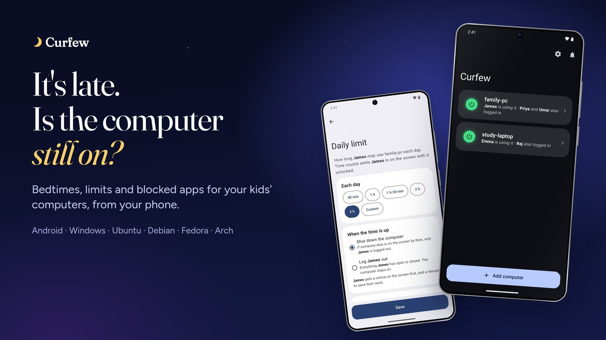</p>

<p align="center"><b><a href="https://sharjeelmazhar.github.io/Curfew/">Website</a> · <a href="https://github.com/sharjeelmazhar/Curfew/releases/latest">Download</a> · <a href="#1-install-curfew-on-the-computer">Install</a></b></p>

**See and control your kids' computers from your Android phone.** Curfew works at home on your Wi-Fi and from anywhere else, with nothing extra to set up. The computers can be Windows 10 or 11, Ubuntu, Debian, Fedora or Arch.

## What you can do from your phone

| | |
|---|---|
| **See what is happening** | Whether each computer is on, who is using it, which apps are open with their logos, which websites are open and what they searched for, within seconds. Screenshots of a child's screen, when you ask or every few minutes, to swipe through like your phone's gallery |
| **Screen time** | A week of each child's time as a bar chart, and every app with its time today and this week, most used first |
| **Set the rules** | Daily screen-time limits, bedtimes, open hours, blocked apps (press and hold any app, or one switch for Minecraft from any launcher, Discord, Roblox or Steam) and websites, no private windows, only installed programs |
| **Filters** | An adult filter (family-safe internet and strict safe search) and an AI filter for ChatGPT, Gemini, DeepSeek and about 90 more, all the time or only in school hours |
| **Safe from the start** | Every child account gets only installed programs, the adult filter, the AI block, 1.5 hours of screen time a day and "only with my approval" without you doing anything. Change any of them on the phone |
| **Even when it is off** | Open a computer that is shut down: see its last screen time, apps, websites and screenshots, and change its rules. It gets the changes the moment it comes on, even if your phone is not at home |
| **Act right now** | Shut down or restart, now or on a timer. Lock the screen, log out, or turn the internet off for one account |
| **Log in without the password** | Let your child in from your phone: on Ubuntu the login screen opens their account by itself. Or make an account open only when you allow it |
| **Forgot a password?** | See any account's password on your phone, behind your fingerprint |
| **Get told** | A notification when someone logs in, opens a blocked app, searches for something bad (also when spelled in tricky ways, with a screenshot), or tries to cut the network |

<p align="center">
  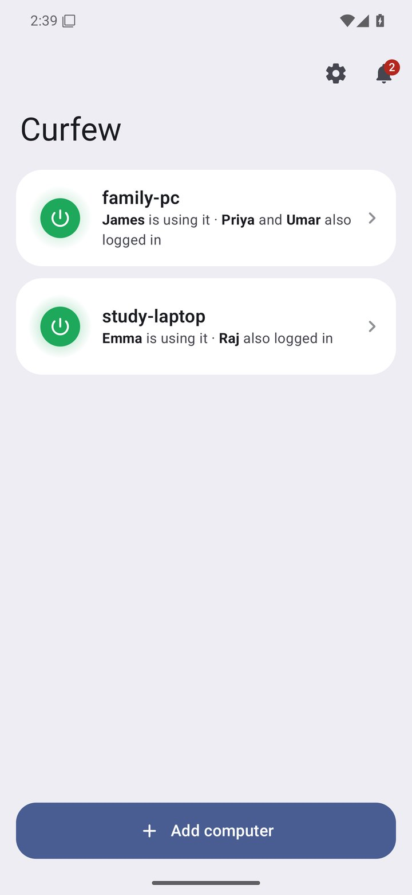
  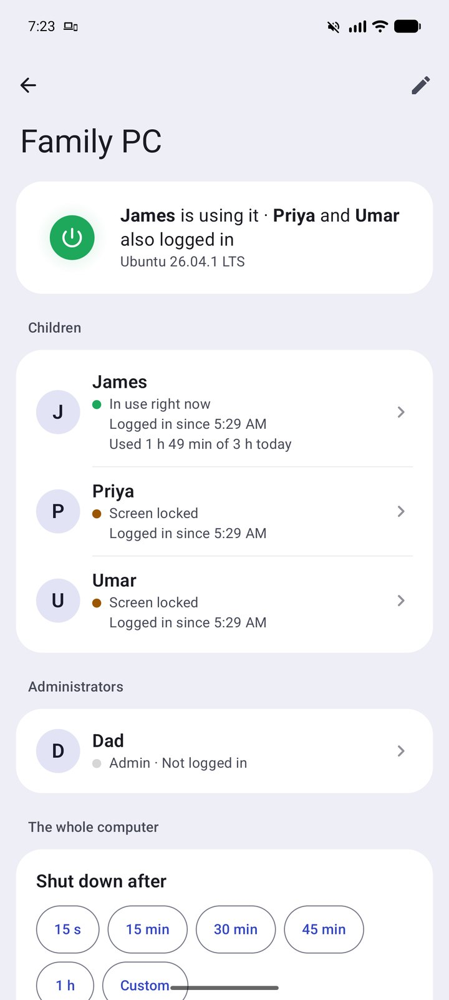
  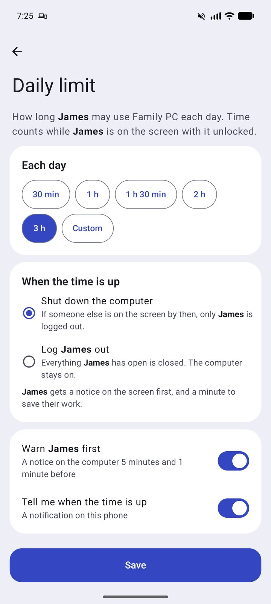
  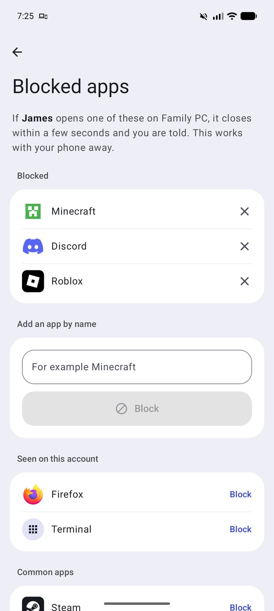
</p>
<p align="center">
  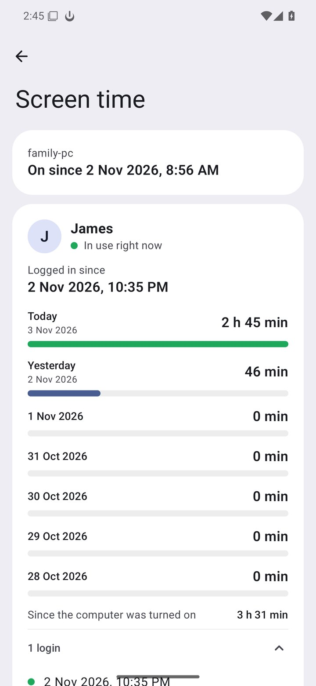
  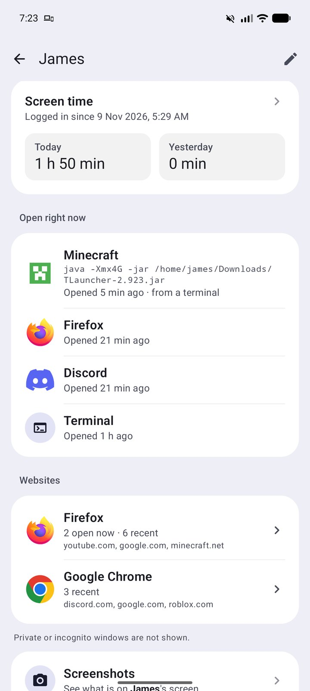
  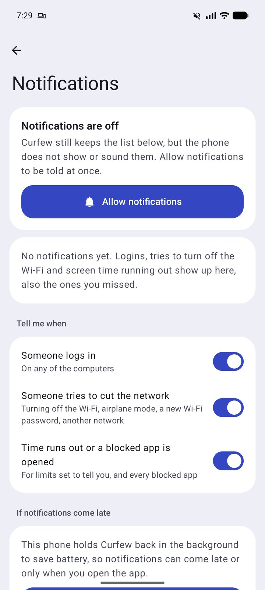
  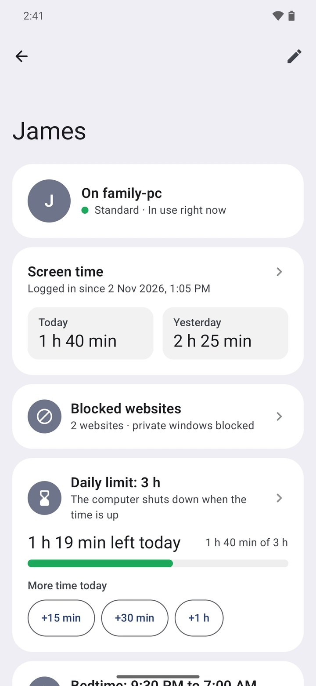
</p>

## On the computer

| Ubuntu | Windows |
|---|---|
| 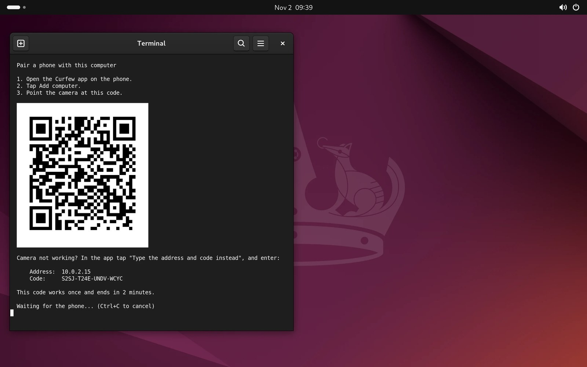 | 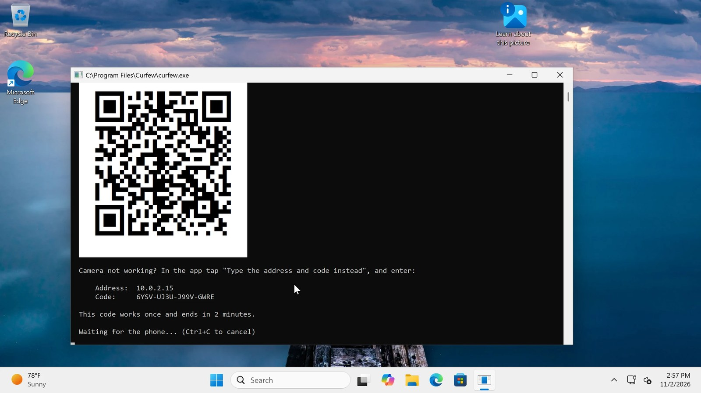 |
| Pair a phone with one command | The same code on Windows 11 |
| 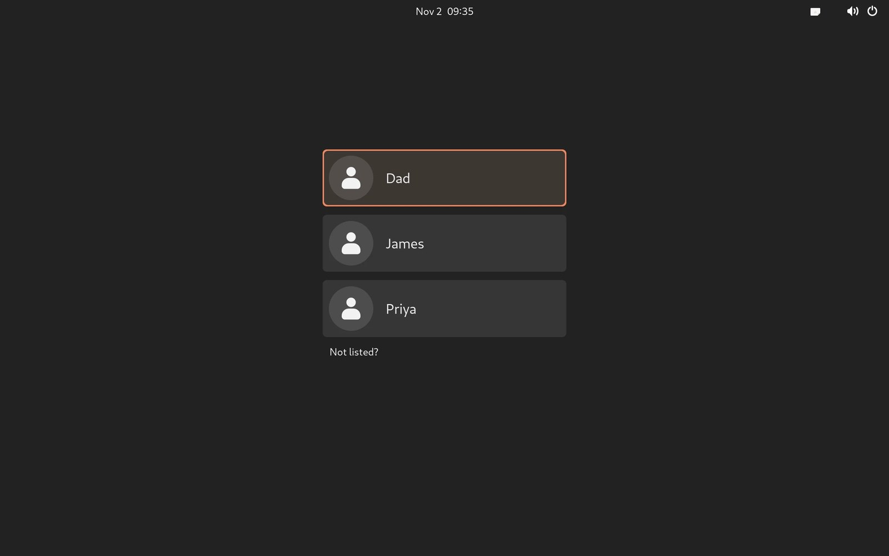 | 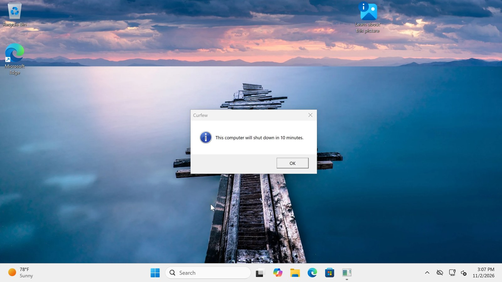 |
| Approve from your phone at the login screen | A warning before a shut-down |

The names in these pictures are made up.

## Install in three steps

### 1. On each computer, from your administrator account

**Windows 10 or 11:** download [CurfewSetup.exe](https://github.com/sharjeelmazhar/Curfew/releases/latest/download/CurfewSetup.exe) and open it. If Windows warns about an unknown publisher, choose **More info**, then **Run anyway**. Then type each child's password once.

**Ubuntu, Debian, Fedora or Arch:** open a terminal and paste:

```
curl -fsSL https://sharjeelmazhar.github.io/Curfew/install.sh | sudo sh
```

Then run `sudo curfew pair`.

### 2. On your Android phone (8 or newer)

Download [Curfew.apk](https://github.com/sharjeelmazhar/Curfew/releases/latest/download/Curfew.apk) on the phone and open it. Allow installing from this source when Android asks. If Play Protect does not recognise it, choose **More details**, then **Install anyway**.

### 3. Connect them

On the same Wi-Fi, tap **Add computer** and scan the code the computer shows. That's all.

**Away from home:** it just works, over mobile data or any other Wi-Fi. There is no account to create, no VPN and no Tailscale to set up. Messages pass through a small relay, sealed with your phone's key, so the relay can't read them.

## Built with

- **Rust** on the computer: fast, memory safe, and one small program with nothing else to install.
- **Kotlin** on the phone: a native Android app.

For everything else, read the **[full guide](docs/GUIDE.md)**: each feature, removing Curfew, troubleshooting, and [what Curfew cannot stop](docs/GUIDE.md#what-curfew-cannot-stop).

---

Designed and developed by **[Sharjeel M. Rajput](https://github.com/sharjeelmazhar)**. © 2026. All rights reserved. Curfew is free to install and use; its source code is private.
